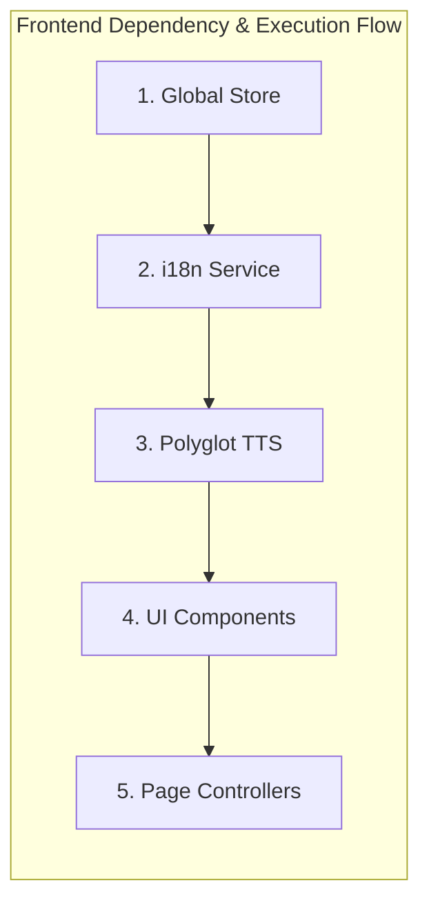
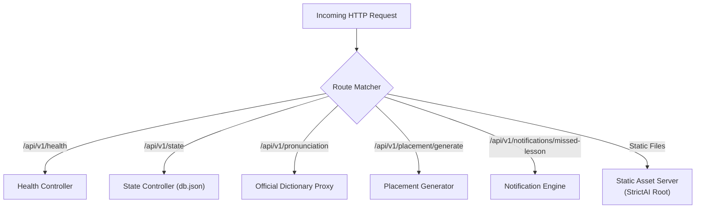

# StrictAI Architectural Specification & System Design

StrictAI is engineered as an advanced, zero-dependency, high-performance educational technology platform adhering strictly to the **«1 Action = 1 Agent»** design principle. This document defines the complete multi-tier frontend and backend architecture.

---

## 1. High-Level System Architecture

```mermaid
graph TD
    subgraph Client ["Frontend Tier (Vanilla ES6 Modules)"]
        PC["Page Controllers<br>(tutor.js, nmt.js, tracker.js, etc.)"] --> Comp["UI Components<br>(components.js, panda-avatar.js)"]
        Comp --> TTS["Polyglot TTS Engine<br>(polyglot-tts.js)"]
        Comp --> I18N["i18n Localization Engine<br>(i18n.js)"]
        Comp --> Store["Global Reactive Store<br>(store.js)"]
    end

    subgraph Server ["Backend Tier (Node.js Core HTTP - Zero Dependencies)"]
        Store -->|"REST API (/api/v1/*)"| HTTP["Node.js HTTP Server<br>(server/server.js)"]
        HTTP --> Health["GET /api/v1/health"]
        HTTP --> StateAPI["GET/POST /api/v1/state"]
        HTTP --> DictProxy["GET /api/v1/pronunciation"]
        HTTP --> Placement["POST /api/v1/placement/generate"]
        HTTP --> NotifEngine["POST /api/v1/notifications/missed-lesson"]
    end

    subgraph Persistence & External ["Persistence & External Services"]
        StateAPI --> DB[(("db.json<br>Persistence Layer"))]
        DictProxy --> ExtAPI["Official Free Dictionary API<br>(api.dictionaryapi.dev)"]
        NotifEngine --> DB
    end
```

---

## 2. Frontend Multi-Tier Architecture

The frontend is structured into five distinct, decoupled layers communicating via reactive state bindings and event dispatchers without heavy framework overhead.



### Tier 1: Global Reactive Store (`js/store.js`)
- **Purpose**: Centralized application state manager maintaining user session, learning streak, vocabulary mastery metrics, and settings.
- **Mechanism**: Implements publish-subscribe pattern (`subscribe(listener)`, `getState()`, `setState(updater)`).
- **Persistence**: Automatically synchronizes state changes with the backend `/api/v1/state` endpoint and `localStorage` for offline resilience.

### Tier 2: i18n Localization Engine (`js/i18n.js`)
- **Purpose**: Provides seamless multilingual support across 6 core languages: English (`en`), German (`de`), Spanish (`es`), Chinese (`zh`), Polish (`pl`), and Ukrainian (`uk`).
- **Mechanism**: Exposes `t(key, params)` translation helper and `setLanguage(lang)` reactive switcher which triggers DOM re-renders across all active page elements carrying `data-i18n` attributes.

### Tier 3: Polyglot TTS Engine (`js/polyglot-tts.js`)
- **Purpose**: Multilingual text-to-speech synthesis wrapper utilizing the browser's native `SpeechSynthesis` API.
- **Features**:
  - Automatically selects the best matching voice for the target language (`en-US`, `de-DE`, `es-ES`, `zh-CN`, `pl-PL`, `uk-UA`).
  - Fallback phonetic pronunciation guides for offline or unsupported browser environments.
  - Rate, pitch, and volume adjustments tailored for language learners.

### Tier 4: Reusable UI Components (`js/components.js`, `js/panda-avatar.js`)
- **Purpose**: Encapsulated DOM builders for recurrent UI patterns (Navigation headers, student profile widgets, modals, audio buttons, progress bars).
- **Panda Avatar**: The interactive gamified mascot (`panda-avatar.js`) providing contextual encouraging feedback, emotion animations (happy, thinking, celebrating), and speech bubbles during tutoring sessions.

### Tier 5: Page Controllers (`js/tutor.js`, `js/nmt.js`, `js/knowledge.js`, `js/tracker.js`, `js/parents.js`, `js/landing.js`, `js/placement.js`)
- **Purpose**: View controllers managing page-specific lifecycles, user event handlers, DOM bindings, and asynchronous API communication.
- **Controllers**:
  - `tutor.js`: Interactive AI tutoring session controller with real-time feedback and vocabulary flashcards.
  - `nmt.js`: Neural Machine Translation workbench and interactive sentence translation tests (`nmt-questions.js`).
  - `knowledge.js`: Knowledge graph explorer and grammar rule repository.
  - `tracker.js`: Gamified progress tracking, streak counters, and skill mastery charts.
  - `parents.js`: Parent portal dashboard providing child progress oversight and notification controls.
  - `placement.js`: Diagnostic placement test controller evaluating proficiency levels.
  - `landing.js`: Marketing home page controller.

---

## 3. Backend Architecture Details

The StrictAI backend (`server/server.js`) is implemented using pure Node.js built-in modules (`http`, `fs`, `path`, `url`, `https`), requiring zero external `npm` dependencies for maximum security, portability, and instant boot time.



### 3.1 REST API Specification (`/api/v1/*`)

| Endpoint | Method | Description | Request Payload / Params | Response |
| :--- | :--- | :--- | :--- | :--- |
| `/api/v1/health` | `GET` | Server liveness & version check | None | `{ status: "ok", timestamp: "...", version: "2.0.0" }` |
| `/api/v1/state` | `GET` | Retrieve complete user state | None | User JSON state object |
| `/api/v1/state` | `POST` | Update and persist user state | Partial or full state JSON | `{ success: true, state: {...} }` |
| `/api/v1/pronunciation` | `GET` | Fetch phonetic IPA & audio | `?lang=en&word=example` | Phonetic data & audio URL |
| `/api/v1/placement/generate`| `POST` | Generate diagnostic test items | `{ level: "A1", count: 10 }` | Randomized question array |
| `/api/v1/notifications/missed-lesson` | `POST` | Trigger missed lesson alert | `{ studentId: "...", parentEmail: "..." }` | `{ success: true, dispatched: [...] }` |

### 3.2 Persistence Layer (`db.json`)
- **Location**: `/home/desty/StrictAI/server/data/db.json` (mirrored in scratch workspace).
- **Data Structure**: Stores user profiles, vocabulary items, lesson timestamps, streak statistics, and notification logs in JSON format.
- **Concurrency & Safety**: Implements atomic file writing with synchronous JSON serialization to prevent race conditions during rapid state updates.

### 3.3 Official Dictionary Proxy
- **Mechanism**: When a frontend client requests pronunciation data for a vocabulary term, the backend proxies requests to the **Free Dictionary API** (`https://api.dictionaryapi.dev/api/v2/entries/en/<word>`).
- **Resilience**: If the external API is unreachable or rate-limited, the proxy gracefully falls back to built-in offline phonetic dictionaries (`polyglot-dict-data.js`).

### 3.4 Notification Engine
- **Mechanism**: Monitors student activity and scheduled milestones. When a lesson is missed or a streak is at risk, the notification engine records the event in `db.json` and simulates dual-channel alerts for both the student (in-app banner/modal) and parents (email/SMS dashboard log).

---

## 4. Security & Deployment

- **Sandbox & Portability**: Runs seamlessly within standard Linux environments on configurable ports (default 3000).
- **CORS & Headers**: Strict MIME-type resolution for JavaScript modules (`application/javascript`), CSS (`text/css`), and JSON.
- **Directory Traversal Protection**: Secure static asset loader prevents directory traversal attacks by validating resolved file paths against the document root.
